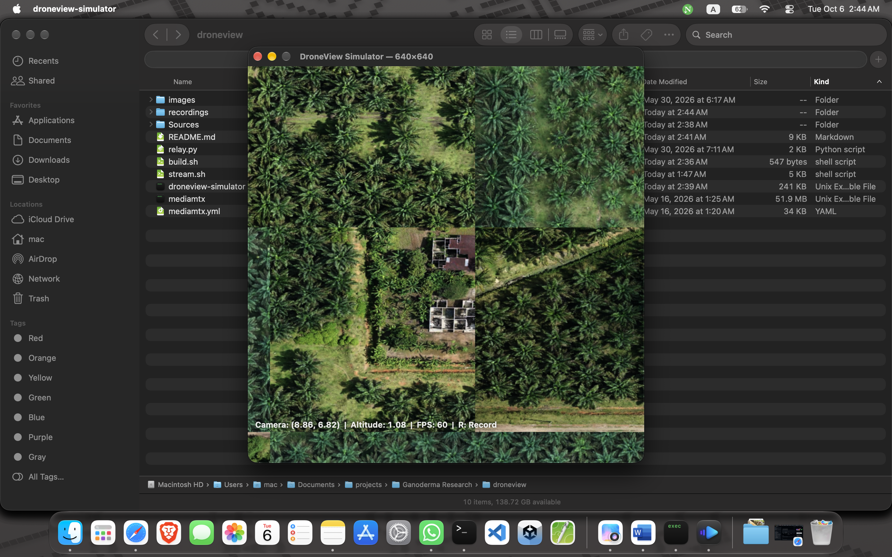

# 🛸 DroneView Simulator

A Metal-based top-down terrain viewer written in Swift. Navigate a grid of aerial images as if flying a drone — pan, zoom, and stream the view over RTSP.

## Screenshot



## Features

- **Top-down drone view** — Navigate a ground plane of image tiles with smooth camera movement
- **WASD / Arrow key movement** — Pan across the terrain at speed proportional to altitude
- **H / L altitude control** — Zoom in for detail or out for overview (0.3–25+ world units)
- **C key camera reset** — Instantly return to the starting position
- **R key video recording** — Record the viewport to an MP4 at 30 fps, saved on second press
- **Real-time HUD overlay** — Camera position (X, Z), altitude, and FPS displayed on screen
- **Procedural fallback** — Generates colorful grid tiles when no images are found
- **RTSP live streaming** — Broadcast the Metal viewport as an RTSP video stream via TCP relay + FFmpeg

## Requirements

- **macOS** (AppKit + Metal required)
- **Swift 5** toolchain (Xcode or command-line tools) — needed to build the simulator from source

### Streaming Dependencies

The RTSP streaming pipeline requires three external tools:

| Tool      | Purpose               | Install |
|-----------|-----------------------|---------|
| MediaMTX  | RTSP/RTMP server      | Download from the [releases page](https://github.com/bluenviron/mediamtx/releases) (see below) |
| FFmpeg    | BGRA → H.264 encoding | `brew install ffmpeg` |
| Python 3  | TCP → stdout relay    | `brew install python` (or Xcode command-line tools) |

Optional, for viewing the stream:

```bash
brew install --cask vlc
```

#### MediaMTX

The `mediamtx` binary is **git-ignored** and must be downloaded manually:

1. Go to <https://github.com/bluenviron/mediamtx/releases>
2. Download the macOS tarball for your architecture (`darwin_amd64` for Intel, `darwin_arm64` for Apple Silicon)
3. Extract it and place the `mediamtx` binary in `bin/`:

```bash
tar -xzf mediamtx_*_darwin_*.tar.gz
mv mediamtx /path/to/droneview/bin/
```

The `config/mediamtx.yml` config shipped with this repo is ready to use as-is.

## Quick Start

### 1. Build

```bash
bash scripts/build.sh
```

This compiles `Sources/main.swift` into `bin/droneview-simulator` using the Metal, MetalKit, and AppKit frameworks.

### 2. Prepare Images (optional)

Place JPEG or PNG images in `images/` at the project root (this folder is git-ignored). Run the simulator from the project root and it picks them up automatically. Images are sorted alphabetically and arranged in a square-ish grid.

```
droneview/
├── images/
│   ├── tile_001.jpg
│   ├── tile_002.jpg
│   └── ...
├── bin/
│   └── droneview-simulator
└── ...
```

If no images are found, 16 procedural colored tiles are generated automatically.

### 3. Run

```bash
./bin/droneview-simulator            # 640×640 window (default)
./bin/droneview-simulator --res 1280 # 1280×1280 window
```

A window opens centered on screen with the tile grid visible. Use `--res <WxH | N>` to change the resolution. Press `R` to record video, `R` again to save it.

## Controls

| Key(s)       | Action                        |
|-------------|-------------------------------|
| `W` / `↑`   | Move forward (north / +Z)     |
| `S` / `↓`   | Move backward (south / −Z)    |
| `A` / `←`   | Move left (west / −X)         |
| `D` / `→`   | Move right (east / +X)        |
| `H`         | Increase altitude (zoom out)  |
| `L`         | Decrease altitude (zoom in)   |
| `C`         | **Reset camera** to start position |
| `R`         | **Start / stop video recording** (saves MP4) |
| `⌘Q`        | Quit                          |

Movement speed scales with altitude — you cover more ground when zoomed out.

### HUD Overlay

The bottom-left corner of the window displays:

```
Camera: (X.XX, Z.ZZ)  |  Altitude: X.XX  |  FPS: 60
```

- **Camera** — Current X and Z world coordinates
- **Altitude** — Height above ground (lower = more zoomed in)
- **FPS** — Smoothed frames-per-second (rolling average over ~60 frames)
- **● REC <seconds>** — Recording indicator with elapsed time (shown while recording)

## Video Recording

Press `R` to start recording, and press `R` again to stop and save the video.

**Default resolution (640×640 @ 30 fps):**

```bash
./bin/droneview-simulator        # press R to start, press R again to save
```

**Custom resolution:**

```bash
./bin/droneview-simulator --res 1280       # records at 1280×1280
./bin/droneview-simulator --res 1280x720   # records at 1280×720
```

The recording is captured from the same frame path as streaming, so it also works mid-stream (`--stream` + `R`).

- **Format** — H.264 MP4 at **30 fps**
- **Resolution** — Matches the output resolution: default **640×640**, or whatever was passed via `--res`
- **Location** — Saved to a `recordings/` folder in the directory you launched the app from (git-ignored), with a timestamped name:
  `recordings/recording_2026-10-06_023802_4821.mp4`
- **Clean footage** — The HUD overlay is *not* baked into the video; only the rendered terrain is captured
- Quitting while recording finishes and saves the file automatically

The recording frame rate is tunable in `Sources/main.swift` (`recordFPS`, marked `CHANGE:`), and the encoder bitrate scales with resolution.

## RTSP Streaming

Stream the Metal viewport as a live RTSP video feed viewable in VLC or any RTSP client.

### Architecture

```
┌──────────────────┐     TCP (port 9999)     ┌────────────────┐     raw BGRA     ┌───────┐     RTMP     ┌──────────┐     RTSP     ┌─────────┐
│ droneview-sim    │ ───────────────────────→ │ scripts/relay.py │ ────────────→ │ FFmpeg │ ──────────→ │ MediaMTX │ ───────────→ │ VLC/etc │
│ (--stream flag)  │   size-prefixed frames   │                │   pipe stdout   │        │   H.264        │          │            │         │
└──────────────────┘                         └────────────────┘                  └───────┘                └──────────┘            └─────────┘
```

### Start Streaming

> **Note:** Make sure the [streaming dependencies](#streaming-dependencies) are installed first — in particular, download the `mediamtx` binary into `bin/`.

**Default resolution (640×640 @ 30 fps):**

```bash
bash scripts/stream.sh
```

**Custom resolution (square number or WxH):**

```bash
bash scripts/stream.sh 1280       # 1280×1280
bash scripts/stream.sh 1280x720   # 1280×720
```

This script:
1. Starts **MediaMTX** (RTSP/RTMP server on ports 8554/1935)
2. Starts `bin/droneview-simulator --stream --res <W>x<H>` (TCP server on port 9999)
3. Runs `scripts/relay.py` → **FFmpeg** to encode BGRA frames to H.264 and push to RTMP

### View the Stream

```bash
vlc rtsp://localhost:8554/drone
```

Or from another device on the same network (the script prints the local IP):

```bash
vlc rtsp://192.168.x.x:8554/drone
```

### Stream Configuration

Edit `scripts/stream.sh` to adjust:

| Variable       | Default  | Description                        |
|---------------|----------|------------------------------------|
| `STREAM_W/H`  | 640      | Output resolution (override via command-line arg) |
| `FPS`         | 30       | Stream frame rate                  |
| `BITRATE`     | 4M       | H.264 encoding bitrate             |
| `RTSP_PORT`   | 8554     | MediaMTX RTSP port                 |
| `STREAM_PATH` | `drone`  | Stream path name                   |

## Resolution Flag

The simulator runs at **640×640 by default** — for the window, the stream, and the recording. Change it with the `--res` flag — pass a single number for a square output, or `WxH` for a custom size:

```bash
# Streaming
./bin/droneview-simulator --stream              # 640×640 (default)
./bin/droneview-simulator --stream --res 1280   # 1280×1280
./bin/droneview-simulator --stream --res 1280x720

# Recording
./bin/droneview-simulator                       # 640×640 (default)
./bin/droneview-simulator --res 1280            # 1280×1280
./bin/droneview-simulator --res 1280x720        # 1280×720
```

`scripts/stream.sh` accepts the same format as its first argument (`bash scripts/stream.sh 1280x720`). The rendered frame is produced at exactly the requested resolution (the drawable is pinned to that size, independent of window size or Retina scale), so both the FFmpeg encoder and the video recorder receive frames that match the requested size 1:1 with no scaling.

## Tuning

Key parameters are marked with `CHANGE:` comments in `Sources/main.swift`:

| Parameter              | Location       | Default | Effect                                |
|-----------------------|----------------|---------|---------------------------------------|
| Starting altitude     | `Renderer.init` | `minAlt × 3` | Initial zoom level             |
| View scale            | `draw()`       | 1.8     | Zoom factor (higher = more zoomed out)  |
| Altitude range        | `setupGround()` | auto    | Min/max altitude based on ground size |
| Movement speed        | `update()`     | 0.5×alt | How fast camera pans                  |
| Altitude change speed | `update()`     | 1.5     | How fast H/L zoom                     |
| Camera smoothness     | `update()`     | 12.0    | Lerp exponent (higher = snappier)     |
| Recording frame rate  | `recordFPS`    | 30      | Video recording fps                   |
| Recording bitrate     | `VideoRecorder.init` | auto | Scales with resolution (2 Mbps floor) |

## Project Structure

```
droneview/
├── Sources/
│   └── main.swift          # Full application (renderer, HUD, controls, streaming server, recorder)
├── scripts/
│   ├── build.sh            # Compiles Sources/ → bin/droneview-simulator
│   ├── stream.sh           # RTSP streaming pipeline launcher
│   └── relay.py            # TCP → stdout relay for FFmpeg
├── config/
│   └── mediamtx.yml        # MediaMTX configuration (tracked; used as-is)
├── assets/
│   └── dronsim.png         # Screenshot shown in README
├── bin/                    # ⚠️ git-ignored — holds compiled/downloaded binaries
│   ├── droneview-simulator #   Build output (scripts/build.sh)
│   └── mediamtx            #   Downloaded manually (see below)
├── images/                 # ⚠️ git-ignored — aerial tile images (JPEG/PNG)
├── recordings/             # ⚠️ git-ignored — saved videos (created on first press of R)
├── .gitignore
└── README.md
```

### Where to put what

| File / Folder            | Where it goes                                                  | Tracked by git? |
|--------------------------|----------------------------------------------------------------|-----------------|
| Swift source             | `Sources/main.swift` (put code here)                           | ✅ yes          |
| Aerial tile images       | `images/` — any `.jpg` / `.jpeg` / `.png` tiles, sorted alphabetically | ❌ no (ignored) |
| Compiled simulator       | `bin/droneview-simulator` — created by `bash scripts/build.sh` | ❌ no (ignored) |
| MediaMTX binary          | `bin/mediamtx` — download from the [releases page](https://github.com/bluenviron/mediamtx/releases) and extract into `bin/` | ❌ no (ignored) |
| MediaMTX config          | `config/mediamtx.yml` (tracked; edit settings here)            | ✅ yes          |
| Build / stream scripts   | `scripts/` (`build.sh`, `stream.sh`, `relay.py`)               | ✅ yes          |
| Screenshots / docs media | `assets/` (e.g. `dronsim.png`)                                 | ✅ yes          |
| Saved recordings         | `recordings/` — created automatically in the folder you run the app from | ❌ no (ignored) |
| Any other media data     | Keep it out of the repo (or add it to `.gitignore`)            | —               |

Rules of thumb:

- **Code → tracked.** Anything in `Sources/`, `scripts/`, `config/`, `assets/`.
- **Binaries & data → ignored.** Anything in `bin/`, `images/`, `recordings/` is ignored by `.gitignore`, so `git add .` will never pick them up.

The simulator looks for the `images/` folder in: the current working directory, next to the binary (`bin/images/`), or the project root — so running `./bin/droneview-simulator` from the project root is all you need.

## License

This project is provided as-is for simulation and prototyping purposes.
